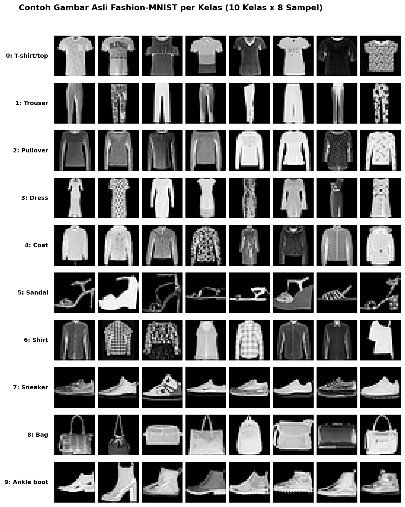
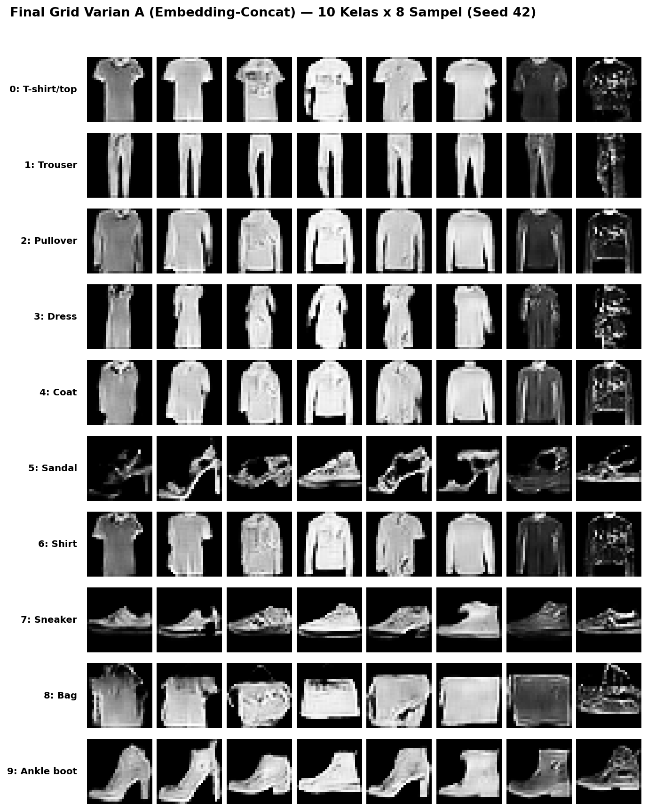
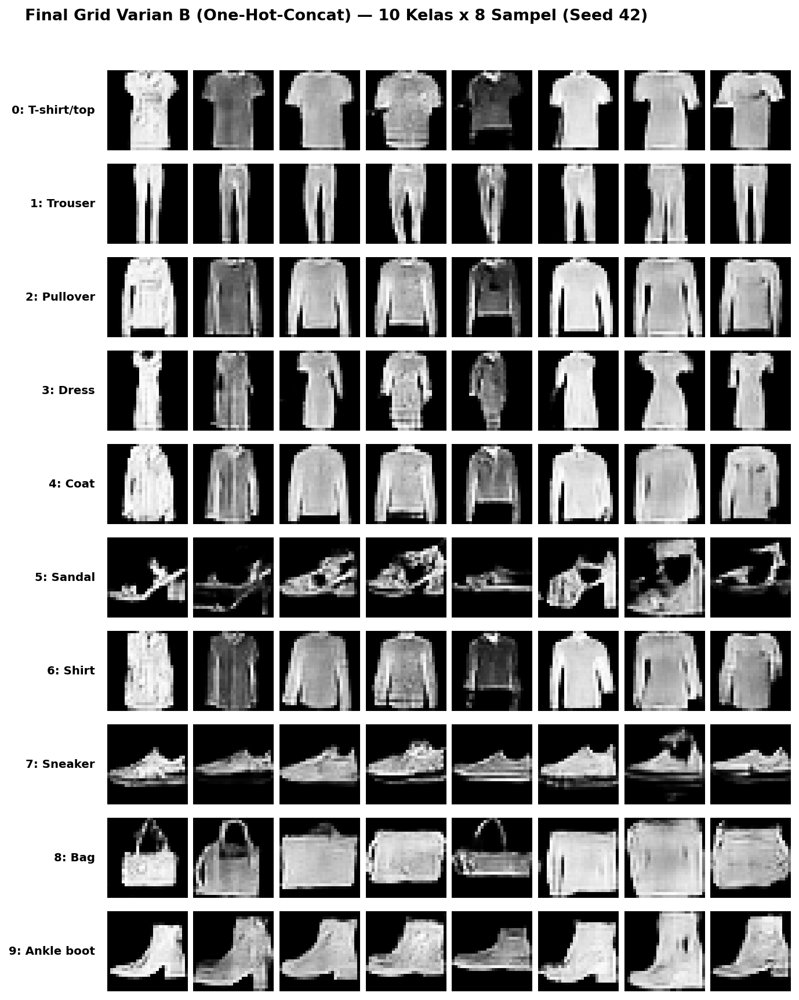
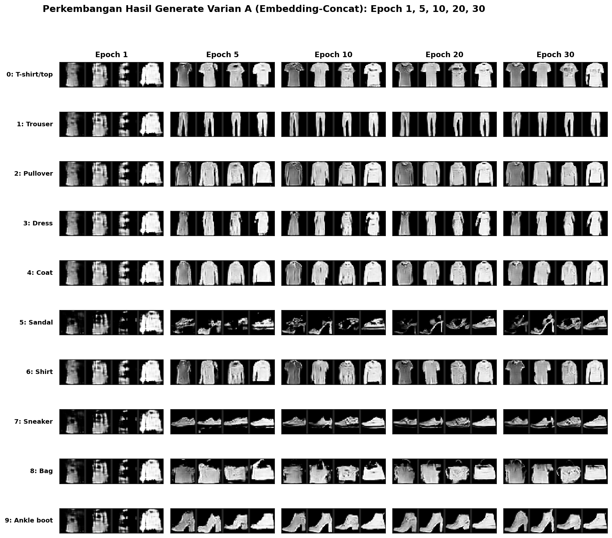
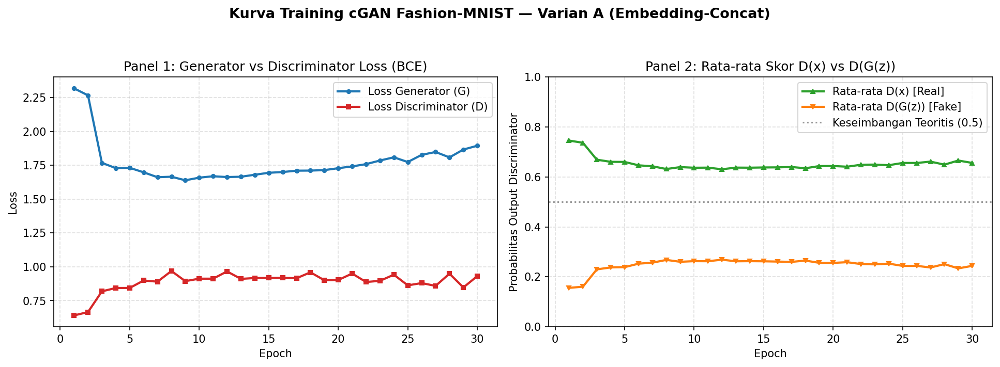
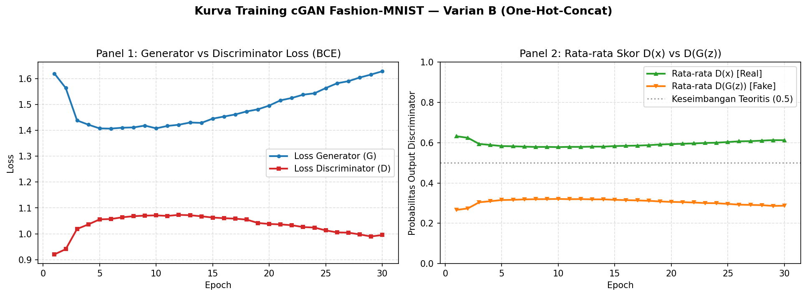
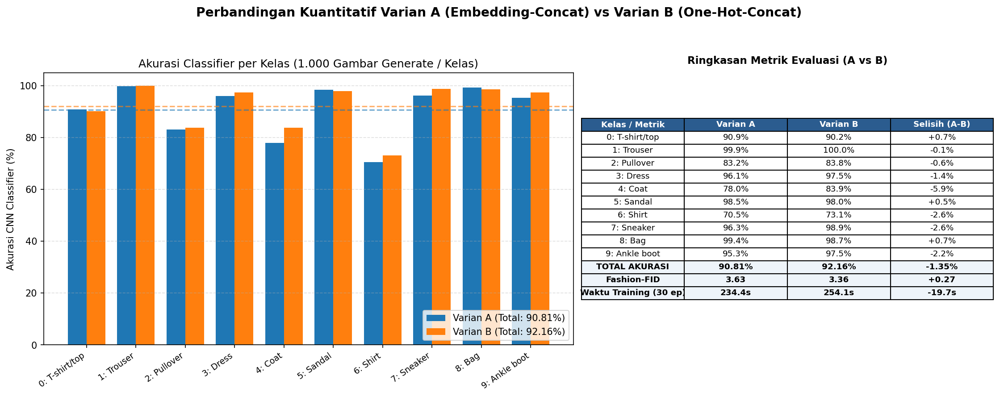

# Conditional GAN (cGAN) Klasik pada Fashion-MNIST (Varian A vs Varian B)

Proyek ini mengimplementasikan, melatih, dan membandingkan dua strategi *conditioning* pada **Conditional GAN (cGAN)** untuk menghasilkan gambar pakaian **Fashion-MNIST (`1x28x28` grayscale)** sesuai kelas (`0–9`):
- **Varian A (`embedding-concat`)**: Menggunakan `nn.Embedding(10, 10)` di Generator (`100 + 10 = 110`) dan `nn.Embedding(10, 784)` (`1x28x28`, total `2x28x28`) di Discriminator.
- **Varian B (`one-hot-concat`)**: Menggunakan vektor *one-hot* `(10)` di Generator (`100 + 10 = 110`) dan peta *one-hot* konstan `10x28x28` (`1 + 10 = 11` channel, `11x28x28`) di Discriminator tanpa `nn.Embedding`.

---

## Ringkasan Hasil Eksperimen (GPU Kaggle `Tesla T4`)

| Metrik Evaluasi | Varian A (`embedding-concat`) | Varian B (`one-hot-concat`) | Selisih (`A - B`) |
|---|---:|---:|---:|
| **Waktu Training (30 Epoch)** | `234.35 detik` (`7.81s/ep`) | `254.08 detik` (`8.47s/ep`) | `-19.73 detik` |
| **Jumlah Parameter Generator** | `764,709` | `764,609` | `+100` |
| **Jumlah Parameter Discriminator** | `147,553` | `148,929` | `-1,376` |
| **Loss G / Loss D Akhir (Epoch 30)** | `1.8946` / `0.9315` | `1.6284` / `0.9953` | — |
| **Skor Akhir D(x) / D(G(z))** | `0.6560` / `0.2439` | `0.6123` / `0.2871` | — |
| **Akurasi CNN Classifier (Data Asli Test)** | `93.21%` | `93.21%` | — |
| **Akurasi CNN Classifier Total (10.000 Gambar Generate)** | **`90.81%`** | **`92.16%`** | **`-1.35%`** |
| **Fashion-FID (Lebih Rendah = Lebih Baik)** | **`3.63`** | **`3.36`** | **`+0.27`** |
| **Verifikasi Demo vs `final_grid` (Seed 42)** | `Max Diff = 0` (`MSE = 0.0`) | `Max Diff = 0` (`MSE = 0.0`) | `100% Identik` |

Detail analisis lengkap tersedia di [`ANALISIS.md`](ANALISIS.md) dan catatan eksperimen di [`LLM_LOG.md`](LLM_LOG.md).

---

## Galeri Hasil Visual (`outputs/`)

### 1. Contoh Gambar Asli Fashion-MNIST (`outputs/sample_real.png`)


### 2. Perbandingan Hasil Akhir: Varian A vs Varian B (`outputs/final_grid_A.png` & `outputs/final_grid_B.png`)
| Varian A (`embedding-concat`) | Varian B (`one-hot-concat`) |
|---|---|
|  |  |

### 3. Perkembangan Pelatihan Varian A: Epoch 1, 5, 10, 20, 30 (`outputs/progress_A.png`)


### 4. Kurva Loss & Skor Discriminator (`outputs/loss_curve_A.png` & `outputs/loss_curve_B.png`)



### 5. Evaluasi Kuantitatif Akurasi Classifier per Kelas (`outputs/comparison.png`)


---

## Cara Menjalankan Web Demo Interaktif (Gradio)

### Opsi 1: Langsung setelah Clone Repository Ini
```bash
git clone https://github.com/fazarirazkaa/cGAN_Fashion-MNIST.git
cd cGAN_Fashion-MNIST
pip install -r requirements.txt
python app/demo.py
```

### Opsi 2: Menggunakan Paket Mandiri (`demo_package.zip`) — 3 Baris Instruksi
```bash
unzip demo_package.zip -d fashion_cgan_demo && cd fashion_cgan_demo
pip install -r requirements.txt
python app/demo.py
```

---

## Cara Menjalankan Ulang Training di Kaggle Notebook
1. Buka notebook [`fashion_mnist_cgan.ipynb`](fashion_mnist_cgan.ipynb) di Kaggle Notebook.
2. Aktifkan GPU melalui menu kanan **Settings > Accelerator > GPU T4 x2 / GPU P100** dan nyalakan **Internet** (atau tambahkan dataset `zalando-research/fashionmnist` sebagai input fallback).
3. Klik **Run All** — seluruh tahapan dari pengecekan GPU, *smoke test*, training 30 epoch Varian A & B, evaluasi CNN Classifier (`10.000` gambar generate), visualisasi, verifikasi demo, hingga pembuatan `demo_package.zip` akan berjalan otomatis dari atas ke bawah tanpa error.

---

## Struktur File Repository
```text
cGAN_Fashion-MNIST/
├── app/
│   └── demo.py                 # Web demo interaktif Gradio (Varian A & B, interpolasi NEAREST 140x140)
├── models/
│   ├── classes.json            # Daftar resmi 10 kelas Fashion-MNIST (0–9)
│   ├── generator_A.pth         # Bobot Generator Varian A (Embedding-Concat)
│   └── generator_B.pth         # Bobot Generator Varian B (One-Hot-Concat)
├── outputs/
│   ├── sample_real.png         # Grid 10x8 contoh gambar asli Fashion-MNIST
│   ├── final_grid_A.png        # Grid 10x8 hasil akhir Varian A (Epoch 30)
│   ├── final_grid_B.png        # Grid 10x8 hasil akhir Varian B (Epoch 30)
│   ├── progress_A.png          # Perkembangan Varian A pada Epoch 1, 5, 10, 20, 30
│   ├── loss_curve_A.png        # Kurva Loss G/D & Skor D(x)/D(G(z)) Varian A
│   ├── loss_curve_B.png        # Kurva Loss G/D & Skor D(x)/D(G(z)) Varian B
│   ├── comparison.png          # Grafik & tabel perbandingan akurasi Classifier A vs B
│   ├── comparison.csv          # Data tabel perbandingan A vs B
│   ├── metrics_A.csv           # Log metrik per epoch Varian A
│   ├── metrics_B.csv           # Log metrik per epoch Varian B
│   └── summary_report.json     # Ringkasan lengkap metrik eksperimen
├── fashion_mnist_cgan.ipynb    # Notebook Kaggle lengkap (Tahap 1–14)
├── demo_package.zip            # Paket mandiri siap jalankan di laptop (CPU)
├── requirements.txt            # Dependensi minimal untuk menjalankan demo
├── ANALISIS.md                 # Laporan analisis perbandingan Varian A vs Varian B
├── LLM_LOG.md                  # Log tahapan pengembangan dan perbaikan kendala
└── README.md                   # Dokumentasi utama dan tampilan hasil
```
